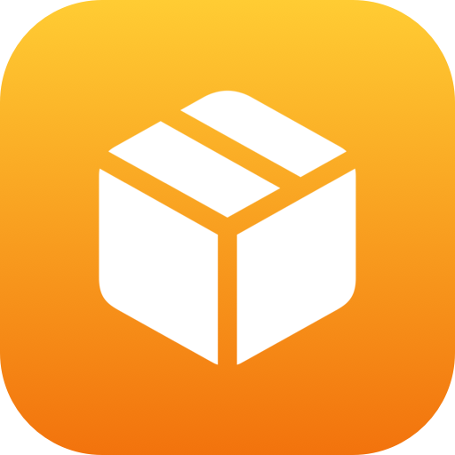
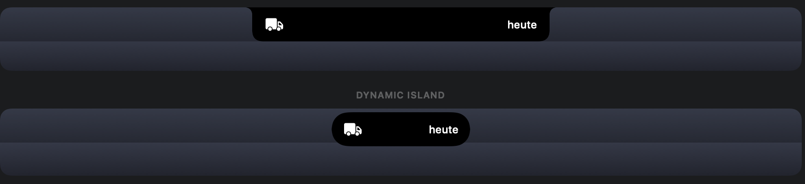
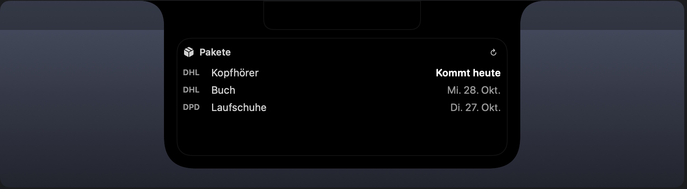
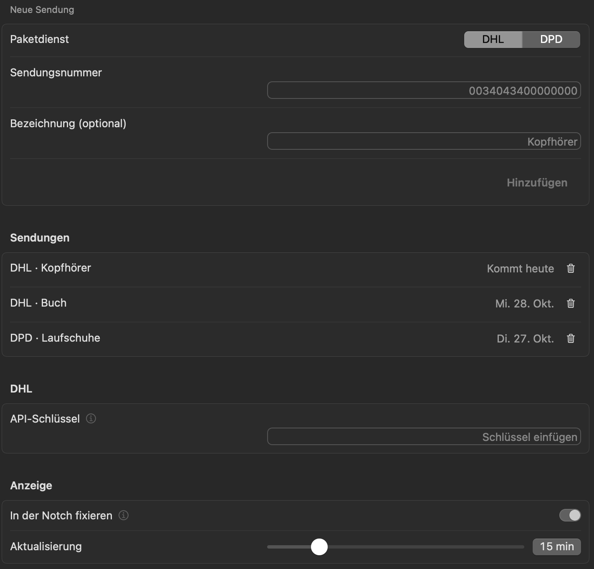

<div align="center">



# Paket-Tracking für Droppy

**Dein Paket kommt heute? Die Notch sagt es dir.**

DHL- und DPD-Sendungen als Live-Aktivität, gebaut als [Droppy](https://getdroppy.app) Droplet.
Sendungsnummer eintragen, den Rest erledigt die Notch.

[](CHANGELOG.md)
[](#voraussetzungen)
[](https://getdroppy.app)
[](https://getdroppy.app/docs/droppykit)
[](Package.swift)
[](LICENSE)

</div>

---

<p align="center">
  
</p>

## Funktionen

- 📦 **DHL und DPD**: mehrere Sendungen gleichzeitig, jede mit eigener Bezeichnung
- 🏝️ **„Kommt heute“ in der Notch**: eine Live-Aktivität erscheint, sobald ein Paket in Zustellung ist oder für heute angekündigt wurde
- 🚚 **Zustellfahrzeug-Symbol**: aus der Paketbox wird ein Lieferwagen, wenn das Paket unterwegs zu dir ist
- 🗂️ **Übersicht im Shelf**: Status und voraussichtliches Datum je Sendung, solo und im Paar
- 🔄 **Automatische Aktualisierung**: alle 5 bis 60 Minuten, per Knopfdruck auch sofort
- 📌 **Fixierbar**: dauerhaft neben der Notch oder nur beim Darüberfahren
- 🧹 **Räumt auf**: zugestellte Pakete verschwinden nach drei Tagen
- 🔒 **Lokal**: keine Konten, kein Server dazwischen, Abfragen gehen direkt an DHL und DPD

## Screenshots

<p align="center">
  <br>
  <sub>Das Shelf-Widget: heute fällige Pakete stehen oben und sind hervorgehoben</sub>
</p>

<p align="center">
  
</p>

## So funktioniert es

```
 Sendungsnummer eintragen  ─▶  Abfrage alle 15 min  ─▶  „In Zustellung“ oder Zustelldatum heute  ─▶  „heute“ in der Notch
```

1. **Sendung hinzufügen**: Paketdienst wählen, Sendungsnummer und optional eine Bezeichnung eintragen.
2. **Das Droplet fragt den Status ab** und sortiert die Sendungen: heute fällig, unterwegs, zugestellt.
3. **Kommt ein Paket heute**, nimmt die Live-Aktivität neben der Notch Platz. Bei mehreren steht dort „2 heute“.
4. **Hover oder Klick** öffnet das Shelf mit der Übersicht.
5. **Zugestellt?** Dann verschwindet die Aktivität von selbst.

## Voraussetzungen

- Ein Mac mit **macOS 14 Sonoma** oder neuer
- **[Droppy](https://getdroppy.app) 15.3** oder neuer
- Für DHL: ein kostenloser API-Schlüssel (siehe unten). DPD braucht keinen.

## Installation

1. Lade **[`PaketTracking.droplet.zip`](dist/PaketTracking.droplet.zip)** herunter und entpacke sie.
2. Öffne in Droppy **Einstellungen › Store › Lokale Droplets** und ziehe **`PaketTracking.droplet`** hinein.
3. Bestätige das Droplet, wenn Droppy fragt. Droppy fragt bei jedem Start erneut, weil der Build nicht vom Droppy Store signiert ist.

> [!TIP]
> Zum Ausprobieren ohne Eingriff in dein Droppy-Setup eignet sich das kostenlose [Droppy Playground](https://getdroppy.app/download/playground). Kopiere das Bundle nach
> `~/Library/Application Support/Droppy Playground/Droplets/paket-tracking/`.

## Einrichtung

Öffne **Paket-Tracking** in den Droppy-Einstellungen:

1. **DHL-Schlüssel** (nur für DHL-Sendungen): Registriere dich kostenlos auf [developer.dhl.com](https://developer.dhl.com), lege eine App mit dem Produkt **Shipment Tracking – Unified** an und füge den API-Schlüssel ein.
2. **Neue Sendung**: Paketdienst wählen, Nummer eintragen, auf *Hinzufügen* klicken.
3. **Anzeige**: Lege fest, ob „heute“ dauerhaft neben der Notch stehen soll, und wie oft abgefragt wird.

| Einstellung | Bedeutung |
| --- | --- |
| In der Notch fixieren | An: „heute“ bleibt sichtbar, solange ein Paket zugestellt wird. Aus: nur beim Darüberfahren |
| Aktualisierung | Abfrageintervall von 5 bis 60 Minuten |

## Wann gilt „kommt heute“?

| Quelle | Bedingung |
| --- | --- |
| DHL | Status „In Zustellung“ (Zustellfahrzeug), oder die voraussichtliche Zustellung liegt heute |
| DPD | Status „In Zustellung“ |

Zugestellte Pakete und Sendungen mit Problem lösen die Aktivität nicht aus.

## Datenschutz

- Sendungsnummern und der DHL-Schlüssel liegen nur lokal in den Droplet-Einstellungen von Droppy.
- Es gibt keinen eigenen Server. Abfragen gehen ausschließlich an `api-eu.dhl.com` und `tracking.dpd.de`.
- Das Droplet verlangt nur die Berechtigung **Netzwerk (ausgehend)**.

## Hinweise

- Der DPD-Abruf nutzt den öffentlichen Endpunkt der DPD-Sendungsverfolgung. Er ist nicht offiziell dokumentiert und kann sich ändern.
- DHL begrenzt kostenlose Schlüssel auf eine feste Zahl Abfragen pro Tag. Bei vielen Sendungen das Intervall erhöhen.

## Fehlerbehebung

| Problem | Lösung |
| --- | --- |
| Status zeigt „Fehler“ | In den Einstellungen steht der Grund hinter der Sendung |
| „DHL-API-Schlüssel fehlt“ oder „ungültig“ | Schlüssel unter *DHL* neu einfügen |
| „Sendung nicht gefunden“ | Nummer prüfen. Neue Sendungen tauchen oft erst Stunden nach der Anmeldung auf |
| „Zu viele Abfragen“ | Intervall erhöhen |
| „heute“ erscheint nur beim Darüberfahren | *In der Notch fixieren* einschalten |

## Aus dem Quellcode bauen

Paket-Tracking ist ein Swift-Paket, gebaut mit [DroppyKit](https://getdroppy.app/docs/droppykit).

```bash
git clone https://gitlab.com/droppyformac1/droppykit.git
export PATH="$PWD/droppykit/Scripts:$PATH"

git clone https://github.com/janluca22467/droppy-parcel.git
cd droppy-parcel
droppykit build      # erzeugt .build/PaketTracking.droplet
droppykit validate
droppykit run        # öffnet den DroppyKit-Harness
```

<details>
<summary><b>Projektstruktur</b></summary>

```
droplet.json                       Manifest: Id, Version, Berechtigungen, Oberflächen
Package.swift                      Droplet-Bibliothek und Harness
Sources/PaketTracking/
  PaketTrackingDroplet.swift       Zustand, Abfrage-Takt, Live-Aktivität, Widget
  ParcelModel.swift                Modelle, Parser für DHL und DPD, Netzwerk
  ParcelViews.swift                Notch-Ansicht, Widget, Einstellungen
PaketTracking.icon/                App-Icon
docs/images/                       Bilder für diese README
```
</details>

## Lizenz

[MIT](LICENSE) © [Jan-Luca](https://github.com/janluca22467)

Paket-Tracking ist ein unabhängiges Projekt und steht in keiner Verbindung zu DHL, DPD oder Droppy.
